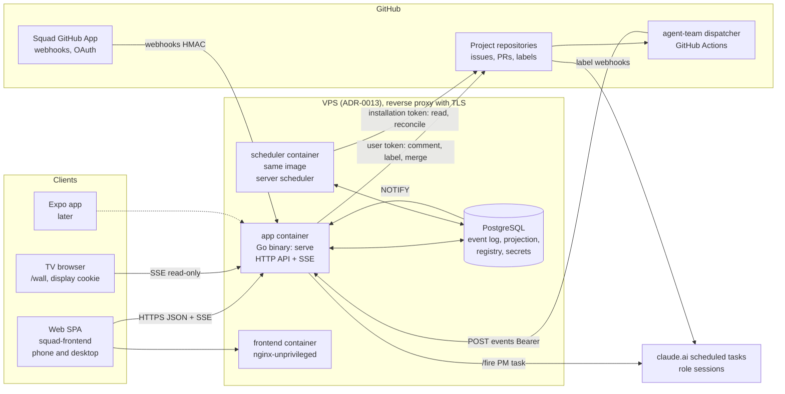
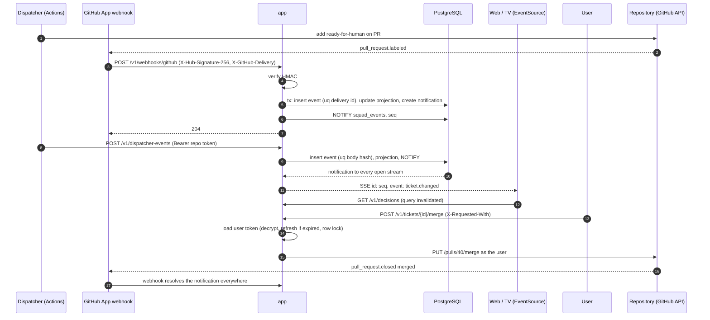
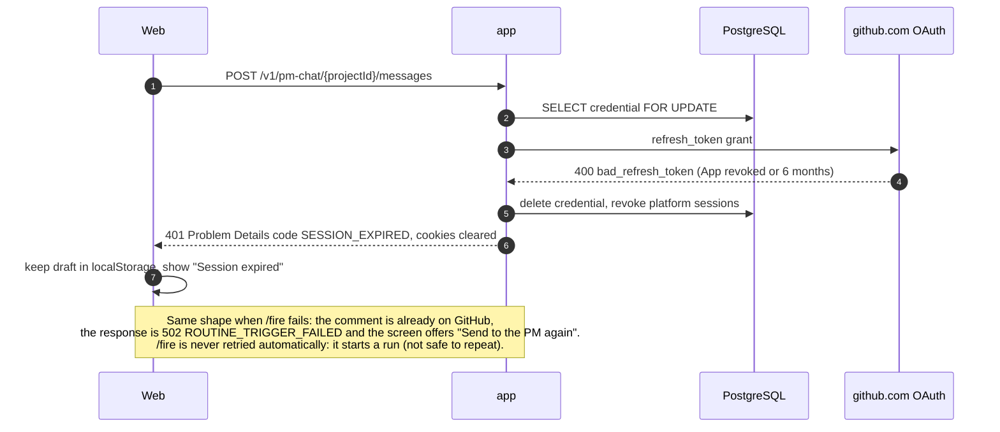
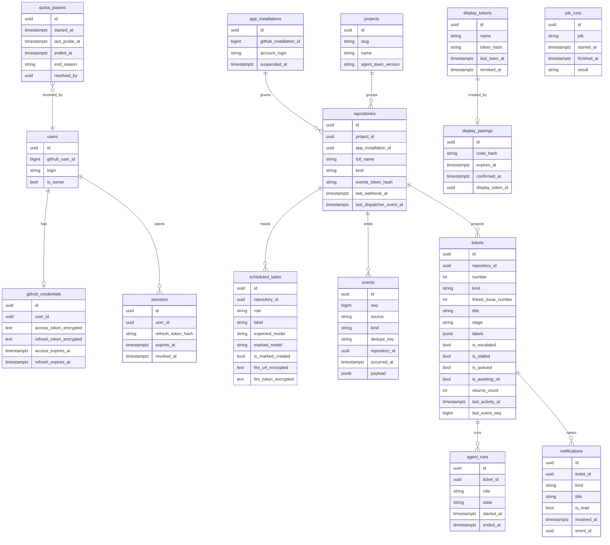

# Squad: architecture plan

Status: proposal for the human. Built on `.scratch/platform/spec.md` (its decisions are settled and not reopened here). Written by the Architect role (`agent-team/roles/architect.md`). The repositories do not exist yet: they will be `squad-backend` and `squad-frontend`, generated with `/new-project`; this plan feeds that interview (Q6) and the first tickets.

## 0. Stack

### What the factory can generate

`/new-project` generates a **Go** backend (`recipes/backend/go.md`, the learning stack, chosen by the user in D1 and proven by the Go run of `.scratch/go-backend/`), a **React** frontend with shadcn/ui and **PostgreSQL**, with **no authentication and no extra mechanisms**. Everything Squad needs beyond the skeleton (GitHub login, SSE, the scheduler process, encryption) is **built by tickets in the project**, not by the generator.

### Backend: Go (`recipes/backend/go.md`), one backend organised in modules

| Concern | Choice | Why (source) |
|---|---|---|
| Language / framework | **Go** with `net/http` + **Huma**, clean architecture in `internal/domain`, `internal/application`, `internal/infra` | D1: the user asked for Go, the learning stack (`go.md`, Status): explanatory pull requests (`## Go notes`), stricter gates. Goroutines make SSE cheap. |
| Runtime | **One binary**, distroless `prod` image (24.8 MB measured), on the VPS | `go.md` items 3 and 4; `vps-deploy.md`; ADR-0013. |
| Database | **PostgreSQL** (container, named volume, scheduled dump) | Records with relations and reports across them (metrics, timeline): `decision-guide.md`, database row; ADR-0013. `jsonb` holds raw event payloads; `LISTEN/NOTIFY` wakes the SSE streams. |
| Data access / migrations | **sqlc + goose** on `pgx`: plain SQL queries, typed code generated into `internal/infra/database/sqlc`, migrations embedded and applied by `serve` at start | `go.md` *Choices* and item 10; `vps-deploy.md` *Migrations*. The scheduler process runs `scheduler`, which **never** migrates (risk R6). |
| API contract | **Huma** generates the OpenAPI 3.1 → committed `openapi.json`, checked by `openapi:check`; frontend generates with orval | ADR-0008; `go.md` items 6 and 13. |
| Auth | **GitHub App OAuth (user-to-server) run server-side**, then the Template's own session: two `httpOnly` JWT cookies (`golang-jwt/jwt`, access 15 min, rotating refresh 7 days stored hashed) plus `logged_in=1` | Settled by A2 and the Login table; ADR-0009 (backend owns login, provider is an adapter behind `AuthServiceInterface`). GitHub is not in the decision guide's provider list (Cognito, Firebase, Auth0, Clerk), so it gets a platform ADR (D3). The OAuth calls are two HTTP requests with `net/http`. |
| GitHub API | **`google/go-github`** behind ports, on `net/http` clients with explicit timeouts; **App JWT** (RS256, `golang-jwt/jwt`) → installation tokens for reads; **the user's token for every write** | A1: writes as the user. Reads with the installation token do not depend on a live session (the scheduler reconciles while nobody is signed in). Retry ×3 with jitter (`cenkalti/backoff`) only on 429/503/timeouts of **safe** calls (`clean-architecture.md`, Resilience). |
| Live updates | **SSE** with a `net/http` handler that flushes (`http.Flusher`) one goroutine per stream; one **hub** goroutine per process holds a dedicated `pgx` connection `LISTEN`ing on PostgreSQL and fans out to the streams, which replay from the event log by sequence (`Last-Event-ID`); streams close after 5 min and the browser reconnects | `decision-guide.md`: "SSE first, WebSocket when the client must send as well" (T3). D2. The hub is in memory per process; PostgreSQL stays the bus between `app` and `scheduler`, with no new container. |
| Scheduler | **`/app/server scheduler`** in its own `scheduler` container (one replica, same image, another command): `time.Ticker` loops calling use cases, each run inside `pg_try_advisory_lock` so two never overlap | A4, an explicit exception to "in-process schedulers are forbidden" (`clean-architecture.md`, Extra mechanisms; `go.md` Mechanisms), recorded as a platform ADR. D8. |
| Queue | **None.** Webhooks and dispatcher events are processed in the request; reconciliation repairs what is missed | A4 and D9. |
| Encryption at rest | `EncryptionServiceInterface` in `application`, adapter on the standard library's **AES-256-GCM** (`crypto/aes`, `crypto/cipher`) with its own key `SECRETS_ENCRYPTION_KEY` and previous keys for rotation (key id in each ciphertext), in the Portainer stack env | A3; `clean-architecture.md` names the encryption service port; ADR-0013. Display and events tokens are **hashed** (SHA-256), not encrypted (D5). |
| Rate limit | `golang.org/x/time/rate` limiters in memory, per key, on the pairing, login and client-errors routes | `go.md` Libraries; one `app` replica (D6). |
| Tests | `testing` + testify, mockery mocks of the ports, integration against the Compose PostgreSQL (`app_test`); GitHub, routine trigger and clock mocked at their ports; recorded GitHub payloads in `tests/fixtures`; always `-race` | ADR-0003; `clean-architecture.md` Testing rules; `go.md` item 12. |

### Frontend: React SPA (`recipes/frontend/react.md`, `libraries.md`, `architecture.md`, `security.md`)

| Concern | Choice | Why |
|---|---|---|
| Framework | React + TypeScript strict, Vite SPA, React Router, **shadcn/ui** + Tailwind, pnpm | The only frontend available (`new-project.md`:47); `libraries.md`. No SSR: a private app, no SEO (ADR-0007). |
| Server data | TanStack Query in each page's hook over orval call functions | `libraries.md`; `architecture.md` (only pages have data hooks). |
| Live updates | Native `EventSource` (`withCredentials`) in `shared/realtime`: one connection per tab; each SSE message invalidates the matching query keys (`tickets`, `decisions`, `wall`, `notifications`), so screens keep one data path | SSE from the decision guide; no library needed. The notification counter is a query, not a store; Zustand only if a later need appears (`libraries.md`). |
| Auth | `logged_in` cookie guard, axios interceptor refresh-once-then-`/login`, `X-Requested-With` on writes; "Session expired" screen keeps drafts in `localStorage` | `security.md`; Login table of the spec. |
| TV | Route `/wall` in the same SPA, read-only, using the `display` cookie set at pairing; TV type scale from the design system | T1, T2. |
| Language | **pt-BR only, no i18n** (the boards are in pt-BR; `libraries.md`: "i18n none by default") | D7. |
| Tests | Vitest (unit + integration projects), Testing Library, MSW with the orval mocks, axe | `react.md` item 9; `quality-gates.md`. |
| Production | `nginx-unprivileged` alpine-slim serving `dist/` | `vps-deploy.md`. |

Mobile (Expo, A5) comes later through add mode; it uses the same API with Bearer tokens (`X-Client: mobile`, ADR-0009) and an SSE client for React Native (it has no `EventSource`), to be decided then.

## 1. Context

The user leads an AI agent team (agent-team: PM, Architect, Designer, Devs, QA, Reviewer, Release, Coach) across several projects. GitHub holds the state of the work (Q3) and the dispatcher moves it with labels; the user today follows it on GitHub. Squad lets the user **see everything waiting for them and act on it** (Decisions), **watch the team live** (the TV wall), **follow each project** (control room, ticket) and **talk to the PM** (chat), from the web on a phone or desktop. First slice, in order (T5): Decisions, team wall, control room, PM chat; then notifications, ticket, health, quota, metrics, New Project.

The platform keeps only what GitHub lacks (A3): an append-only event log, a projection for the screens, the project registry and encrypted secrets. It never starts an agent except through GitHub labels and the PM task's `/fire` (P1b).

## 2. Components

Backend modules (folders by feature inside each layer, `clean-architecture.md`): `auth`, `projects` (registry, repositories, scheduled tasks), `ingestion` (webhooks, dispatcher events), `timeline` (event log, projection, reconciliation), `decisions`, `control` (pause, comment, retry, chat), `notifications`, `displays` (pairing, wall), `health`, `quota`, `metrics`.

## 3. Main flow

### 3a. A label change reaches every screen, and the user decides from the phone

### 3b. Main failure: the GitHub refresh fails while the user acts

## 4. Services and mechanisms

| Mechanism | Used for | Allowed by |
|---|---|---|
| PostgreSQL | everything stored (A3) | decision guide, Database; ADR-0013 |
| SSE (`net/http` + `http.Flusher`, a `LISTEN` hub per process) | live screens and TV (T3) | decision guide, realtime "SSE first" |
| PostgreSQL `LISTEN/NOTIFY` as the events adapter | wake streams on writes from `app` and `scheduler` | decision guide lists events (pub/sub) as a port + adapter; this adapter is not named in any recipe: **D2** |
| Scheduler container (`schedule:work`) | reconciliation every 15 min (A4), quota probe every 30 min (M4), daily digest (F5), pruning expired pairings | **exception** to `clean-architecture.md` Extra mechanisms, settled by A4; platform ADR |
| GitHub App (webhooks, OAuth, App JWT) | A1, A2 | spec A1/A2; third-party API behind ports (`GitHubIssuesServiceInterface`, `GitHubOAuthServiceInterface`) with timeouts and safe retries |
| claude.ai routine API trigger (`/fire`) | PM chat (P1b) | third-party API behind `RoutineTriggerServiceInterface`; timeout 10 s, no retry, circuit breaker not needed at this volume. The request shape is **not documented in any file read**; the ticket verifies it against claude.ai first (R5) |
| Encryption service | GitHub tokens, `/fire` URL and token (A3) | `clean-architecture.md` (encryption service port) |
| Logger with masking | every use case | `clean-architecture.md` Observability; `token`, `secret`, `authorization`, `fireUrl` added to the masked names |
| No queue, no Redis, no email, no file storage, no push | — | not needed (M2: notifications in-platform only) |

## 5. Data model

Database naming of `clean-architecture.md` (plural snake_case, UUID v7 `id`, `created_at`/`updated_at` on every table, omitted below for brevity, named constraints).

- `events` is append-only (no update or delete in its repository); `seq` is a `bigserial` used as the SSE id; `uq_events_dedupe_key` makes ingestion idempotent: `github:<X-GitHub-Delivery>`, `dispatcher:<sha256 of body>` (the dispatcher's JSON has no id, `agent-team/dispatcher/events.js`), `reconciliation:<repo>:<number>:<hash of state>`.
- `tickets` and `agent_runs` are the projection; `projection:rebuild` truncates and replays `events`, then reconciles with GitHub. The agent states of T1 (working, waiting for you, queued, stalled, free) are computed from `agent_runs` + `tickets`, never stored.
- Notification replacement (M2): a partial unique index on `(ticket_id, kind) WHERE is_read = false` makes "a newer one replaces an unread older one" an upsert.
- Preferences for the optional notifications ("PR ready for merge", digest) are two booleans on `users` (`is_merge_notification_enabled`, `is_digest_enabled`).

## 6. Contract

All under `/v1`, Problem Details with `code` and `traceId` (ADR-0011), writes `204` unless stated, display fields formatted by the backend with raw twins (`clean-architecture.md`, *The backend serves the screens*). Cross-project screens take `?projectId=` (absent = all projects, the current-project rule).

### Auth and access

| Endpoint | Notes | Errors |
|---|---|---|
| `GET /v1/auth/github/start` | 302 to GitHub with `state` in a short-lived signed cookie | — |
| `GET /v1/auth/github/callback?code&state` | checks `state`, exchanges the code, rejects any GitHub user id other than the owner's (`OWNER_GITHUB_LOGIN`, pinned to its id at first login), stores the token encrypted, sets `session` + `logged_in`, 302 to the app | `AUTH_STATE_INVALID`, `AUTH_NOT_OWNER` |
| `POST /v1/auth/refresh` · `POST /v1/auth/logout` | ADR-0009 | `SESSION_EXPIRED` |
| `GET /v1/account` | the account, paired screens, the App's repositories with and without access, install URL | — |

### Ingestion

| Endpoint | Notes | Errors |
|---|---|---|
| `POST /v1/webhooks/github` | public; `X-Hub-Signature-256` HMAC with `GITHUB_WEBHOOK_SECRET` (`hash_equals`), deduplicated by `X-GitHub-Delivery`; events: `issues`, `issue_comment`, `pull_request`, `pull_request_review`, `check_suite`, `workflow_run`, `label`, `installation`, `installation_repositories`; answers `204` in well under GitHub's 10 s, including duplicates | `WEBHOOK_SIGNATURE_INVALID` (401) |
| `POST /v1/dispatcher-events` | `Authorization: Bearer <events token>`; the token is per repository (issued on the project's health screen, set as the repository's `AGENT_TEAM_EVENTS_TOKEN` secret, URL = this endpoint as `AGENT_TEAM_EVENTS_URL`); body is the dispatcher's JSON (`at`, `repository`, `trigger`, `target`, `started`, `added`, `removed`, `comments`, `queued`, `awaitingOk`, `escalated`); `repository` must match the token's | `EVENTS_TOKEN_INVALID` (401), `REPOSITORY_NOT_REGISTERED` (404) |

### Live stream

| Endpoint | Notes |
|---|---|
| `GET /v1/stream` | session cookie; `text/event-stream`, `X-Accel-Buffering: no`; `id:` is the event `seq`; honours `Last-Event-ID` (replays from the log); `: ping` every 15 s; closes after 5 min with `retry: 2000`. Events: `ticket.changed {ticketId, projectId}`, `agent.changed {role}`, `notification.changed {unreadCount}`, `pause.changed {state, reason}`, `activity.appended {line}`. Payloads are hints; the screen refetches its endpoint. |
| `GET /v1/wall/stream` | `display` cookie or session; same events filtered to titles and states, never comment bodies (T2) |

### Screens and actions (first slice)

| Endpoint | Returns / does | Errors |
|---|---|---|
| `GET /v1/decisions` | everything waiting for the user: supervised `/ok`, `spec-ready`, escalations with both sides' evidence, dependency fixes, merges; each with `canMerge`, `canOk`, `canTieBreak` | — |
| `POST /v1/tickets/{id}/ok` · `/merge` · `/tie-break {winner: dev\|qa}` · `/retry` | as the user: `/ok` comment; merge; F8 decision comment + labels; F8 retry (clear `escalated`/`stalled`, restore stage and `run:` label) | `TICKET_ACTION_NOT_ALLOWED` (409), `GITHUB_UNAVAILABLE` (502), `REPOSITORY_NO_ACCESS` (403) |
| `POST /v1/tickets/{id}/comments {body}` | F6, as the user | same |
| `GET /v1/wall` | counters (waiting for you, running of `maxConcurrent`, queued, production up/down), one column per role, unread notifications, ticker | `DISPLAY_TOKEN_REVOKED` (401) |
| `POST /v1/display-pairings` | public, rate-limited; **201 with body** `{pairingId, code, expiresAt}` (the feature needs it; stated per `clean-architecture.md`) | `RATE_LIMITED` |
| `GET /v1/display-pairings/{id}` | `pending` or `confirmed`; on confirmed sets the `display` cookie once | `PAIRING_EXPIRED` |
| `POST /v1/display-pairings/confirm {code, name}` · `GET /v1/displays` · `DELETE /v1/displays/{id}` | session only | `PAIRING_CODE_INVALID` |
| `GET /v1/projects` · `GET /v1/projects/{id}/control-room` | registry for the selector; one project's board, role cards with model and the "change the scheduled task too" hint | — |
| `POST /v1/team/pause` · `POST /v1/team/resume` | F4, writes the paused state the dispatcher respects (open in agent-team) | `GITHUB_UNAVAILABLE` |
| `PUT /v1/scheduled-tasks/{id}/api-trigger {url, token}` | stores the PM task's `/fire` URL and token encrypted | — |
| `POST /v1/pm-chat/{projectId}/messages {issueNumber\|null, body}` | P1a + P1b: comment on the issue as the user (or create a `needs-spec` issue, F2), then `/fire` the PM task naming the issue | `ROUTINE_TRIGGER_NOT_CONFIGURED` (409), `ROUTINE_TRIGGER_FAILED` (502) |

Later slices follow the same shape: `GET /v1/tickets/{id}` (M1), `GET /v1/notifications?filter=&kind=&page=&size=` + `POST /v1/notifications/read-all` (M2), `GET /v1/projects/{id}/health` + `POST .../health/check` (M3), `POST /v1/quota/resume {reason: quota\|not-quota}` (M4), `GET /v1/standup` (F5), `GET /v1/metrics?range=` , `PUT /v1/projects/{id}/roles/{role}/model` (opens the `.agents/config.json` pull request). Always: `GET /health`, `POST /v1/client-errors`.

## 7. Risks and alternatives

| # | Risk | Mitigation |
|---|---|---|
| R1 | SSE behind the reverse proxy is buffered or cut | `X-Accel-Buffering: no`, 15 s pings, proxy read timeout above 5 min, the server's `WriteTimeout` off only on stream routes (`http.ResponseController`); streams end every 5 min and resume by `Last-Event-ID`, so a cut loses nothing. |
| R2 | A stream goroutine leaks after the browser leaves | Every stream ends on `request.Context().Done()`, on the 5-minute recycle and on a failed write; the hub drops a subscriber whose buffer is full; one `LISTEN` connection per process, not per stream. A test opens and closes streams and checks the hub's subscriber count. |
| R3 | GitHub refresh tokens are single-use; `app` requests and the `scheduler` refreshing at once would revoke the pair | Refresh only inside a `SELECT … FOR UPDATE` on `github_credentials`; the scheduler reads with installation tokens and only writes (probe) through the same locked path. |
| R4 | Missed webhooks or dispatcher POSTs (VPS down, 5 s dispatcher timeout) | Reconciliation every 15 min writes correcting events; `projection:rebuild` for disasters; Health shows the last webhook, event and reconciliation per repository (M3). |
| R5 | `/fire` request shape and limits are not in any file read; tasks run at most 30 times an hour (`dispatcher/README.md`) | First PM-chat ticket starts by confirming the API with the user; no automatic retry; the error tells the user. The dispatcher may also start the PM on the same human comment (its `needs-spec` rule): a duplicate start to raise with agent-team. |
| R6 | Same image in `app` and `scheduler`: both entrypoints would migrate at once | Entrypoint migrates only when `RUN_MIGRATIONS=true` (set on `app` only); scheduler `depends_on` app healthy. |
| R7 | Secrets leak (tokens in logs, DB dump off the VPS) | Encryption at rest with a key only in the stack env, so the off-VPS dump holds ciphertext; logger masking; display/events tokens hashed; Swagger off in production (ADR-0008). |
| R8 | GitHub API rate limits during reconciliation of many repositories | Installation token (5 000/h per installation), conditional requests with ETags, only open issues and PRs. |
| R9 | Open items in agent-team block buttons: F1, F4 paused state, F8 counting, Pause ticket, Abandon, the M4 probe | Those buttons ship after the matching agent-team release; the platform reads `agent_team_version` from the registry and hides what the version lacks. Suggest agent-team adds an `id` to its events. |

Alternatives considered: **Node (Fastify) backend** (`recipes/backend/node.md`): in-memory SSE fan-out, Octokit, one language with the frontend and the dispatcher; rejected for now only because the factory cannot generate it (D1). **A queue for webhooks**: not needed at this volume (A4). **WebSocket**: the client sends through plain POSTs, so SSE suffices (decision guide). **Separate ingestion service**: no concrete reason (`architect.md`, *Events and separate services*); one backend in modules.

## 8. Tickets

Contract and backend first; each frontend ticket is blocked by the backend ticket that publishes its endpoints. Generation (`/new-project`) comes before all of them.

Backend (`squad-backend`):
1. Project registry and GitHub App configuration (projects, repositories, installations from `installation` webhooks), `GET /v1/projects`, `GET /v1/account`.
2. Login with GitHub: OAuth through the App, owner check, encrypted credential, session cookies, refresh with row lock, logout, `SESSION_EXPIRED`.
3. Event log and GitHub webhook ingestion (HMAC, idempotent by delivery id).
4. Dispatcher events ingestion with per-repository tokens.
5. Projection: tickets and agent runs from the events; `projection:rebuild`.
6. SSE stream with `LISTEN/NOTIFY` and `Last-Event-ID` replay.
7. Decisions: screen endpoint and actions `/ok`, merge, tie-break, retry, as the user.
8. Displays: pairing, display tokens, `GET /v1/wall` and the redacted wall stream.
9. Control room: board endpoint, ticket comment, pause all and resume.
10. PM chat: scheduled task API trigger storage and the message endpoint (comment + `/fire`).
11. Scheduler container, reconciliation every 15 minutes, `job_runs`.
12. Notifications (M2), then ticket screen (M1), health (M3), quota (M4), stand-up (F5), metrics, role model pull request.

Frontend (`squad-frontend`):
1. App shell: side menu with project selector (chip on the phone), auth guard, "Session expired" with drafts kept, account menu.
2. `shared/realtime`: one `EventSource`, query invalidation, reconnect.
3. Decisions screen (desktop and phone).
4. Team wall `/wall` with pairing code, and paired screens in the account menu.
5. Control room.
6. PM chat with local drafts.
7. Notifications, ticket screen, health, quota banner, metrics (in the backend's order).

## Decisions for the human

| # | Decision | Options | Recommendation |
|---|---|---|---|
| D1 | Backend language | Decided: **Go** (the user's choice; `spec.md`, D1). Laravel was the earlier recommendation, while the factory could not generate Go. | — |
| D2 | Bus between `app`, `scheduler` and the SSE streams | (a) **PostgreSQL `LISTEN/NOTIFY`** + replay by `seq`. (b) Each stream polls `events` every 2 s. (c) Redis pub/sub (new container). | **(a)**, with (b) as its fallback when a wait times out; no new container. |
| D3 | GitHub App as the login provider (ADR-0009 lists Cognito, Firebase Auth, Auth0, Clerk) | Settled in spirit by A2; needs the ADR | Record it as an ADR in both repositories. |
| D4 | Who acts for automated platform writes (the M4 probe release) | (a) the user's token, like every write (A1). (b) the App's installation token. | **(a)**, through the locked refresh path, so every change on GitHub keeps one author. |
| D5 | Display and events tokens: hashed instead of A3's "encrypted" | (a) SHA-256 hash (never read back). (b) encrypt as written in A3. | **(a)**: strictly safer; the `/fire` URL and token and the GitHub tokens stay encrypted because they are read back. |
| D6 | Rate-limit store | Decided: in memory (`x/time/rate`) while `app` has one replica; an ADR says a second replica brings a shared store. | — |
| D7 | Product language | (a) **pt-BR only**, no i18n (the boards). (b) pt-BR, en, es as in SpeakBigO. | **(a)**; i18n added by ticket if someone else ever uses it. |
| D8 | Scheduler container (A4) beyond reconciliation | Also the 30-minute quota probe, daily digest, pairing pruning | **Yes**: one container, every timed job in it, each run inside `pg_try_advisory_lock`. |

## ADRs to open in the new repositories

Same number in both repositories where marked "both", next free number after the ones `/new-project` writes.

- **GitHub App login and acting as the user** (both): A1, A2, D3, D4; the session cookies of ADR-0009 on top of the user-to-server token; owner-only.
- **Live updates with SSE** (both): stream contract, event names, `Last-Event-ID`, reconnect, hints-then-refetch; D2 on the backend.
- **Event log and projection** (backend): append-only `events`, dedupe keys, projection rebuild, reconciliation (A3, A4).
- **Scheduler container** (backend): the exception to the recipes' ban, one replica, `RUN_MIGRATIONS` only on `app`, the job list (A4, D8).
- **Secrets at rest** (backend): encryption key and rotation, hashed tokens (D5).
- **Inbound integrations** (backend): GitHub webhook signature and idempotency, dispatcher events tokens, `/fire` without automatic retry.
- **Rate-limit store** (backend): D6.
- **TV display access** (both): pairing, display cookie, read-only redaction (T2).
- **Product language pt-BR without i18n** (both): D7.
